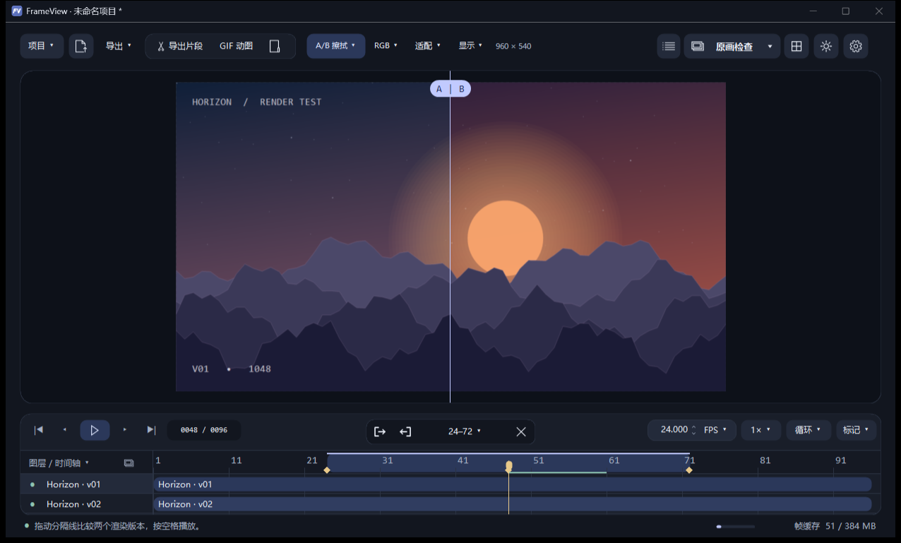
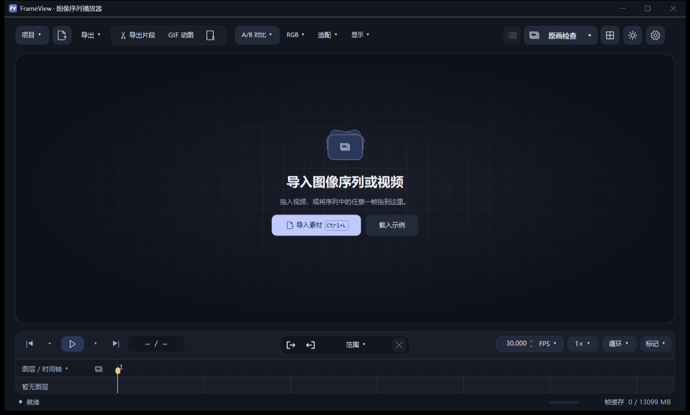
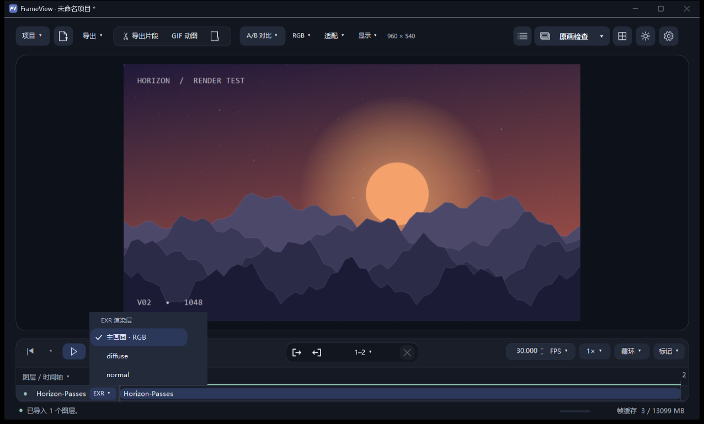
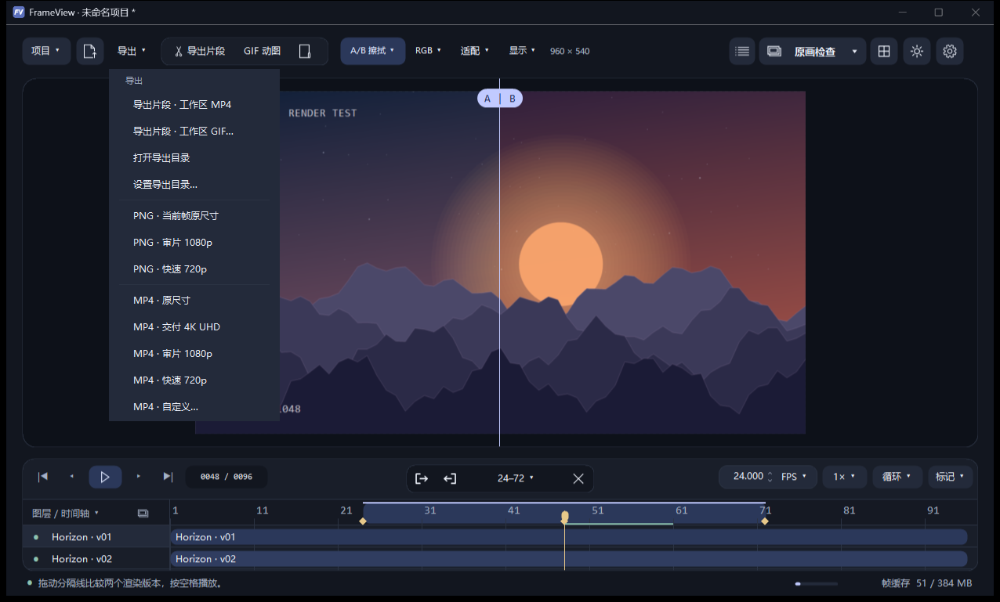

# FrameView

FrameView 是一款 Windows x64 图像序列播放器和审片工具。可逐帧检查渲染结果、切换多层 EXR 的渲染层、对比两个版本，并导出选中的片段。

**[下载 FrameView.exe](https://github.com/Jugui-Lin/FrameView/releases/latest/download/FrameView.exe)** · [版本与 SHA-256 校验值](https://github.com/Jugui-Lin/FrameView/releases/latest)



[下载与配置](#下载与配置) · [导入素材](#导入素材) · [播放与对比](#播放与对比) · [EXR 渲染层](#exr-渲染层) · [导出与保存](#导出与保存) · [快捷键](#快捷键) · [从源码构建](#从源码构建)

## 下载与配置

1. 从 Releases 下载 `FrameView.exe`，双击启动。需要 Windows x64 和 .NET Framework 4.8。
2. 如果多层 EXR 提示加载组件失败，安装 [Microsoft Visual C++ x64 运行库](https://aka.ms/vc14/vc_redist.x64.exe) 后重新启动。
3. 使用视频导入、MP4 或 GIF 导出前，下载 [FFmpeg 9.0.2 Windows Essentials](https://github.com/GyanD/codexffmpeg/releases/tag/9.0.2)。解压后将 `bin` 里的 `ffmpeg.exe` 和 `ffprobe.exe` 放到 `FrameView.exe` 旁。也可将 FFmpeg 加入 PATH，或用 `FRAMEDECK_FFMPEG` 指定 `ffmpeg.exe` 的完整路径。

## 导入素材

- 首次打开可点击「载入示例」，用自带的 Horizon 双版本体验擦拭对比和逐帧检查。
- 点击「导入素材」或按 **Ctrl+L**，也可以把文件拖入监看区。选择编号序列中的任意一帧，例如 `shot.1001.exr`，FrameView 会扫描同目录下编号规则相同的帧，缺帧会保留时间轴位置。
- 只想打开一张编号图像时，使用「项目 → 导入单张静帧」。导入首段视频时会采用源视频的帧率。



## 播放与对比

- **播放与定位** · 按空格播放或暂停，点按时间尺可定位帧。拖动素材条可移动图层，图层名称左边的圆点可切换可见性。右击素材条可重命名、裁切或打开图层属性。
- **A/B 对比** · 从顶部菜单切换图层合成、擦拭或并排。擦拭模式可拖动分隔线，检查同一帧的两个版本。按 **F9** 进入专注审片，标准布局中按 **Tab** 可折叠时间轴。
- **预览与缓存** · 预览按钮在原画、1/2、1/4 间循环。导入时会按分辨率选择预览档位，720p 通常为原画、1080p 为 1/2、4K 为 1/4。点击右侧小三角可选缓存预算，提供总内存的 10%、20%、30% 和自定义百分比。时间尺的绿色细线表示已缓存的帧。
- **设置** · 顶部齿轮可调整新项目默认值、GIF 参数及主题。播放栏右侧可调整帧率、倍率和循环方式。

在监看区横向拖动可逐帧浏览，滚轮缩放，按住右键或中键拖动可平移。时间轴支持 **Ctrl+滚轮** 缩放，点左上角的缩略图按钮可展开各图层的帧预览。

## EXR 渲染层

1. 导入含多个渲染层的 EXR 图像或序列。
2. 点击时间轴图层名称右侧的 **EXR ▾**，直接选择渲染层。也可从图层右键菜单进入。
3. 用顶部「RGB」菜单查看选中渲染层的颜色、Alpha 或亮度通道。



支持无压缩、RLE、ZIPS、ZIP、PIZ、PXR24、B44、B44A、DWAA 和 DWAB 等常见 EXR 压缩方式。监看和合成使用 8 位 RGBA。Deep EXR、浮点 HDR 合成及 OCIO/LUT 暂未提供。

## 导出与保存

1. 把播放头移到片段起点，按 **I** 设置入点。移到终点后按 **O** 设置出点。导出包含入点和出点两帧。
2. 点击顶部「导出片段」输出 MP4，或选「GIF 动图」调整输出尺寸、取帧间隔和颜色数。没有选区时，可在提示中选「导出完整范围」。
3. 「导出 → PNG · 当前帧原尺寸」可保存当前帧及 Alpha。MP4 与 GIF 默认存到 Windows「视频」下的 `FrameView Exports`，可从「导出 → 设置导出目录」更改。
4. 按 **Ctrl+S** 保存 `.fdeck` 工程。工程会记录图层、时间轴和素材路径，移动工程后请确认原素材仍可访问。



## 支持的素材

| 素材 | 格式 |
| --- | --- |
| 图像与序列 | PNG、JPEG、BMP、GIF、TIFF、TGA、EXR、DPX、WebP、HDR |
| 视频 | MP4、MOV、AVI、MKV、WebM、M4V，编解码能力取决于 FFmpeg |
| 导出 | PNG、MP4、GIF |

导入的 GIF 和多页图像按静帧读取。视频监看为静音。单视频图层在画面未调整且项目帧率与源视频一致时，可走快速裁剪并保留第一条音轨。

## 快捷键

| 快捷键 | 操作 |
| --- | --- |
| 空格 / Enter | 播放或暂停 |
| ← / → | 上一帧 / 下一帧 |
| Shift 或 Ctrl + ← / → | 跳 10 或 100 帧 |
| ↑ / ↓ | 正放 / 倒放 |
| Home / End | 工作区首帧 / 尾帧 |
| I / O | 设置工作区入点 / 出点 |
| Alt+Home / Alt+End | 设置工作区入点 / 出点 |
| Shift+I / Shift+O | 将选中图层的入点 / 出点裁到当前帧 |
| M / Shift+M / Ctrl+M | 标记当前帧 / 上一条标记 / 下一条标记 |
| R / G / B / A / L | 切换单通道或亮度，再按一次恢复 RGB |
| Ctrl+W | 切换 A/B 对比 |
| Ctrl+F / Ctrl+G | 定位播放头 / 跳到指定帧 |
| U | 重新扫描素材 |
| F9 / F11 / Tab | 专注审片 / 全屏 / 展开或折叠时间轴 |
| Ctrl+L / Ctrl+O / Ctrl+S / Ctrl+E | 导入素材 / 打开项目 / 保存项目 / 打开导出菜单 |

## 从源码构建

需要 Windows x64、.NET Framework 4.8、PowerShell、支持 Zstandard 的 `tar.exe`，以及 PATH 中的 Zig。依赖准备脚本会下载固定版本并验证 SHA-256。

```powershell
.\scripts\prepare-dependencies.ps1
.\src\build.ps1
```

程序输出到 `build/FrameView.exe`。可用 `-Zig` 指定 Zig 可执行文件的路径。

第三方组件的许可和来源见 [third-party](third-party)。
